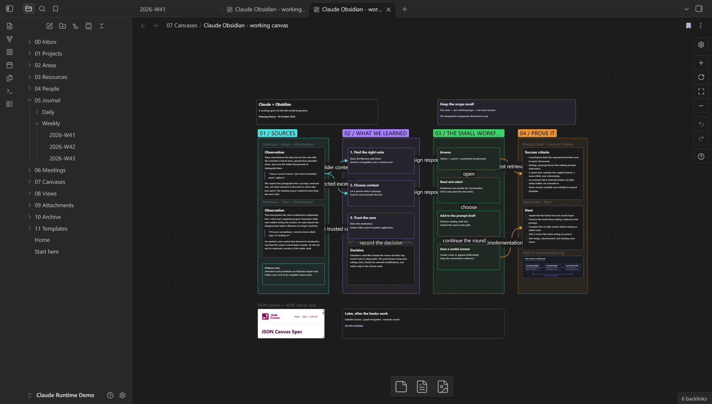

# Claude Desktop × Obsidian

An Obsidian workspace directly inside Claude Desktop: open notes from a navigation tab, keep several vaults within reach, or browse beside a conversation without asking the model to open anything.

The project includes a custom vault viewer and an experimental integration that renders the **actual installed Obsidian application** in an Electron view inside Claude. The real-renderer demo has been exercised in Claude Desktop on Windows.



*This screenshot is a crop of the embedded Obsidian view, showing a fictional demo vault and its Canvas. It does not show the surrounding Claude window.*

## Current capabilities

- **Obsidian navigation tab** alongside Code/Cowork, plus **Vaults** to reopen the last layout.
- Multiple named vaults, native folder selection, search, Markdown editing and stale-save detection in the custom viewer.
- Inline local images, Canvas pan/zoom/Fit and previews of a supported subset of Bases expressions.
- Remembered last note, scroll position, expanded/docked layout, visibility and Canvas camera.
- **Actual Obsidian · demo** loads installed Obsidian's renderer with its real sidebar, tabs, note rendering and Canvas controls. It currently uses a disposable copied demo vault rather than registered user vaults.
- An additional plugin for the official Claude Code mods API and an earlier MCP App implementation.

The Desktop patch and runtime adapter are experimental and version-specific: **Claude Desktop 2.42304.2** and **Obsidian 1.14.4**, tested on Windows 11. This is an independent project, not an official Anthropic or Obsidian integration. The repository contains integration code and a fixture generator; it does not contain either application's binaries or renderer code.

## Local development

Use Windows with Node.js 22 or newer; the current verification environment uses Node.js 24. Install Claude Desktop and, for the real-renderer experiment, Obsidian separately.

```powershell
npm ci
node scripts/create-demo-vault.mjs
npm run build
npm run build:mod
npm test
npm run verify:vault
```

The generator creates **Atelier Demo Vault** with 58 fictional notes, three Canvas boards, three Bases views, attachments, bookmarks and templates. It refuses to overwrite an existing vault. Generated vaults, local configuration, application copies, build outputs and backups are ignored by Git.

To try the custom workspace in a browser:

```powershell
npm run build:desktop -- --build-only
npm run preview:desktop
```

Open `http://127.0.0.1:4318/`. This preview uses disposable fixture copies and does not run the real Obsidian renderer.

## Desktop UI patch

The patch targets the Windows Squirrel installation at `%LOCALAPPDATA%\AnthropicClaude\app-2.42304.2`. It verifies application versions and hashes and creates exact backups. Run from a normal PowerShell session so application-data paths resolve to your installed applications.

```powershell
npm run build:desktop
npm run install:desktop -- --status
```

Save your work and **fully quit Claude Desktop from its tray menu**, then apply the staged patch and reopen Claude:

```powershell
npm run install:desktop
```

Open **Obsidian** in the main navigation for the custom workspace. **Vaults** toggles it in its saved layout. **Actual Obsidian · demo**, beside Vaults at the top right, opens the actual renderer with a copied **Claude Runtime Demo** vault. Its supporting scripts must remain in this checkout.

For updates to an existing patch, stage with `npm run build:desktop -- --update`. When an unapplied stage already exists, supply `--base-manifest` pointing to the manifest of the version actually installed. The installer refuses unknown file changes and a running application.

To restore the previous installation, fully quit Claude and run:

```powershell
npm run restore:desktop
```

Backups and manifests remain under `.local/desktop-ui/`. The patch preserves Electron fuses and the existing CSP. Application updates can require a new compatibility patch. The integration does not configure an inference provider or include API credentials; use Claude Desktop's existing supported account/provider setup.

## Official Code-session mod

The separate mod in `mods/obsidian` adds a launcher above the Code composer and a native notes pane using the official mods API. Its kit has been tested with Claude Code 2.1.303; Desktop's bundled engine and a separately installed CLI can have different versions.

```powershell
npm run build:mod
claude plugin validate ./mods/obsidian
claude plugin test ./mods/obsidian
claude plugin marketplace add .
claude plugin install atelier-obsidian@atelier-local --scope user
```

Reload plugins in a compatible Code session. This mod shares the catalog with the custom workspace and supports explicit note/passage insertion into a prompt and saving a reviewed response as a new note. It is distinct from the real-renderer experiment.

## Earlier MCP App

`npm run build` builds the earlier conversation-hosted MCP view; `npm run install:claude` adds its server configuration with a backup. This variant requires a model tool call to open and is retained separately. `npm run preview` starts its preview on port 4317. Saves there modify the chosen vault, so use a disposable copy when experimenting.

## Verification and limitations

`npm test` currently runs 68 Node tests covering vault boundaries, catalog persistence, concurrent/stale saves, images, Canvas input, saved UI state, rollback, frame trust and runtime isolation/lifecycle. The official mod has a separate `claude plugin test` suite. Windows CI builds generated fixtures and runs the Node suite.

Native Electron checks exercised note/Canvas rendering, resizing, hide/show, host settings, theme-listener preservation and clean shutdown. Browser and mod-kit tests do not establish native pixels; the real-renderer demo has also received a direct visual check inside Claude.

The custom viewer implements a subset of Obsidian features. The real renderer currently uses a copied demo vault. Connecting registered vaults to it, production packaging, community plugins, popouts and embedded browser compatibility remain unfinished. A smaller set of embedded controls is the next UI improvement.

See [architecture](docs/ARCHITECTURE.md) and [runtime experiments](docs/EXPERIMENTS.md) for implementation details.
